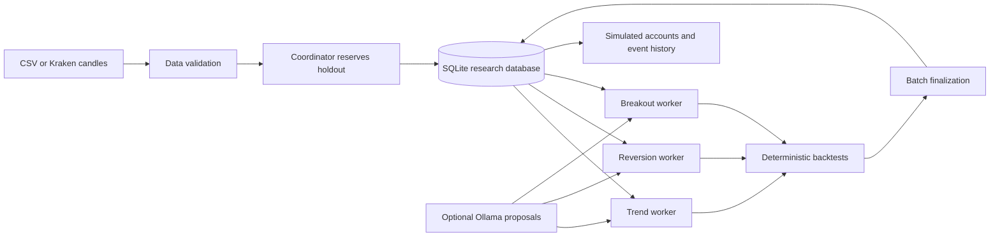

# Architecture

Autarky is a small research system. The coordinator decides when new data can be evaluated. Workers handle one strategy family each. Ordinary Python code does the backtesting and the account arithmetic.

## Modules and ownership

`core.py` parses and checks market data and implements the strategy and cost models. `community.py` owns research and account state. `jobs.py` handles process coordination through SQLite WAL and transactions. `data_audit.py` inspects archives that may not yet meet the evaluator's requirements.

Workers run as independent processes on the same machine. They claim queued jobs using a token and a ten-minute lease. An expired lease can be reclaimed, and a late result from the previous owner is rejected. A batch is finalized only when every worker has reported or a failure has exhausted retries.

## The research boundary

Each batch reserves a future test period before the workers receive their jobs. That period is permanently recorded as consumed. The model sees training summaries and prior training/validation results, while deterministic code selects the candidate on validation data and checks the unseen test and cost stress afterward.

This prevents one easy form of lookahead, but it doesn't solve the broader multiple-testing problem. A human can still overfit by reading test failures and repeatedly redesigning the research process. The [research notes](research.md) discuss that limitation.

## Accounts

Each worker's strategy family has its own simulated account; a separate reserve is not traded. One candle can be processed only once per database. The historical evaluator uses next-open fills after completed signals. The running simulation uses observed bid/ask quotes with configured costs.

The risk stop is checked when a candle and quote are observed. It does not monitor real positions continuously and cannot guarantee a loss limit during a sudden move. No authenticated exchange endpoint or order reconciler exists.

## Scope

This is a single-machine research platform. It isn't a distributed job service or a live execution system. Extending it to manage real funds would require separate order authorization, idempotent execution, reconciliation, independent risk enforcement, monitoring, and a much more extensive validation program.
